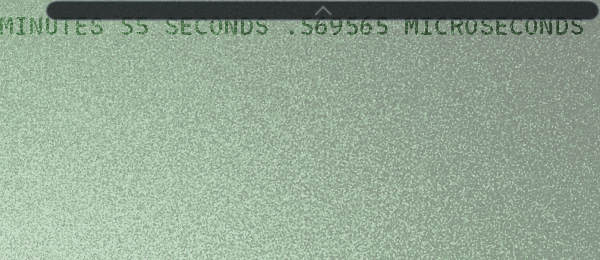
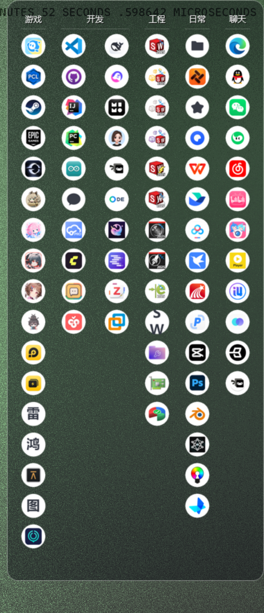

# ShortcutStrip

Rainmeter 桌面快捷方式竖条：**78 个图标 / 5 大分类**，贴屏边自动隐藏，**QQ 式逐帧平滑滑入滑出**，收起后只留一条 14px 的深灰窄条。




## 特性

- **贴哪条边就往哪条边藏**：右边→向左滑出，左边→向右滑出，顶边→向下滑出。
- **角落优先顶边**：面板同时贴着顶边和左/右边时，按顶边处理。
- **平滑滑动**，不是瞬移：Lua 逐帧缓动（约 300ms，18 帧左右）。
- **收起只有一条窄条**：14px 深灰圆角条 + 牵引箭头（`‹` / `›` / `︿`），不挡桌面、不用蓝色手柄。
- **拖动换边**：按住面板拖到任意边，松手后自动吸附并收起。
- 图标自动从桌面收集：桌面 + 公共桌面的 `.lnk` 去重后生成，图标圆形白底，分类标题分组。

## 结构

```
scripts/                     生成器（PowerShell）
  Generate-ShortcutDock.ps1  收集桌面快捷方式 → 生成 Links / Badges / 卡片版皮肤
  Make-BadgeIcons.ps1        把 .lnk 图标做成圆形白底 badge
  Generate-ShortcutStrip.ps1 生成最终的竖条皮肤（含贴边自动隐藏 + Slide.lua）
skin/                        生成产物示例（可直接放进 Rainmeter\Skins）
  ShortcutStrip.ini
  @Resources/Scripts/Slide.lua   贴边方向判定 + 逐帧滑动
  @Resources/*.png               底图 / 分隔线 / 四个方向的窄条
docs/HANDOFF.md              踩坑与机制说明（改造前先读）
screenshots/                 效果图
```

## 使用

1. 安装 [Rainmeter](https://www.rainmeter.net/)（4.5+）。
2. 按顺序跑三个脚本（PowerShell 5.1 即可，无需管理员）：

```powershell
# 1) 收集桌面快捷方式，生成 Links / Badges / 卡片版皮肤
powershell -ExecutionPolicy Bypass -File .\scripts\Generate-ShortcutDock.ps1

# 2) 生成圆形 badge 图标
powershell -ExecutionPolicy Bypass -File .\scripts\Make-BadgeIcons.ps1

# 3) 生成竖条皮肤（含贴边自动隐藏）
powershell -ExecutionPolicy Bypass -File .\scripts\Generate-ShortcutStrip.ps1
```

三个脚本开头都有 `param(...)`，把 `$SrcSkin`、`$SkinDir` 改成你自己的 `Rainmeter\Skins` 路径即可。

3. 刷新 Rainmeter，皮肤会自动贴到它当前所在的那条边并收起。想换边就把面板拖过去。

## 配置

| 位置 | 变量 | 说明 |
|---|---|---|
| `scripts/Generate-ShortcutStrip.ps1` | `$peek` | 收起时露出的窄条厚度（默认 14 逻辑像素） |
| 同上 | `$rowMax` / `$gapX` / `$gapY` / `$badge` | 每列最多几行、列距、行距、图标直径 |
| `Slide.lua` | `tol`（`Setup` 内） | 判定“贴边”的容差（默认 16px） |

`Rainmeter.ini` 里该皮肤的条目必须是：

```ini
[ShortcutStrip]
KeepOnScreen=0     ; 关键：设 1 会把窗口钉死在屏内，永远展开 = 假隐藏
Draggable=1        ; 允许拖动换边
AlwaysOnTop=1
SavePosition=0
```

## 实现要点

- 收起/展开靠 `!Move` 移动**整个皮肤窗口**，窗口固定 370×834（`DynamicWindowSize=0` 由满幅透明 meter 锁尺寸）。
- 方向由 `Slide.lua` 的 `Setup(cx, cy)` 在皮肤刷新时按 `#CURRENTCONFIGX#/#CURRENTCONFIGY#` 判定：`dTop<=16 → top`，否则 `dLeft<=16 → left`，否则 `dRight<=16 → right`，都不贴边按最近的左/右。
- 滑动是 `cur += (tgt-cur)*0.28` 的缓动，每个 Tick `!Move` 一次；滑到目标才隐藏面板组、显示窄条，所以过程里是看得见滑动的。
- 收起后的窄条位置随方向变：右→窗口最左，左→窗口最右，顶→窗口最底。

## 已知坑（详见 `docs/HANDOFF.md`）

- 外部 CLI bang（`Rainmeter.exe !Move` / `!Quit`）对运行中的实例无效，改 ini 必须杀进程后重启。
- `Meter=Shape` 缺 `W/H` 不渲染也不可点，一律用 `Meter=Image`。
- 收起宽度太薄（8px）时面板左边缘是圆角透明，等于完全隐身。

## License

MIT
